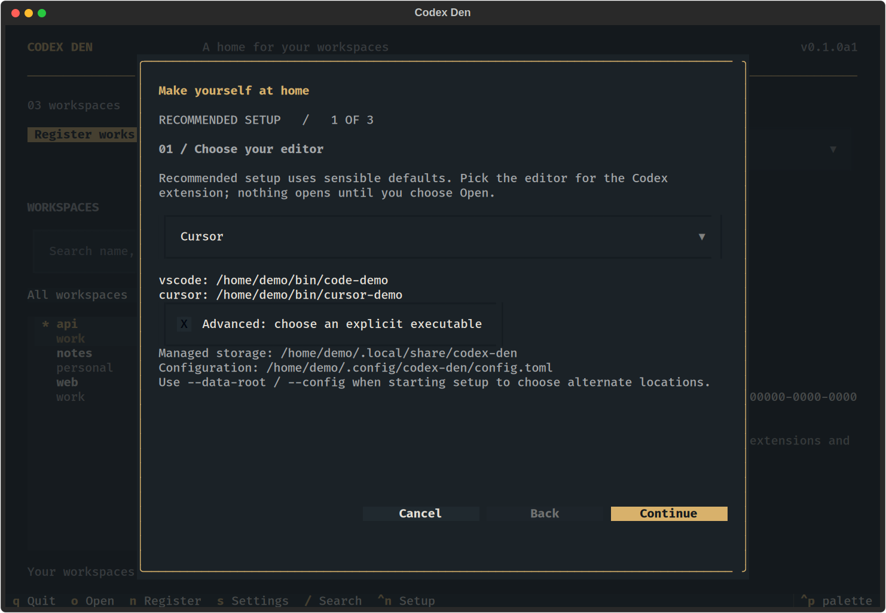
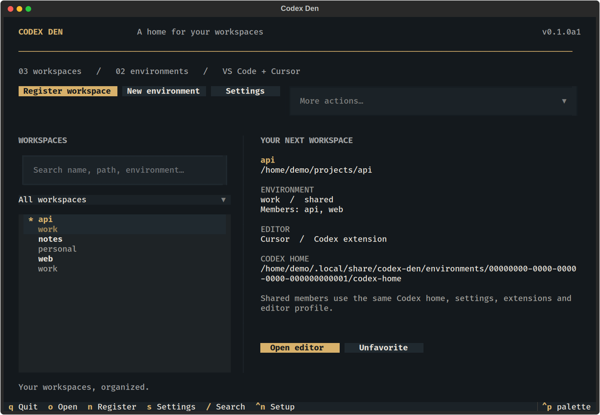
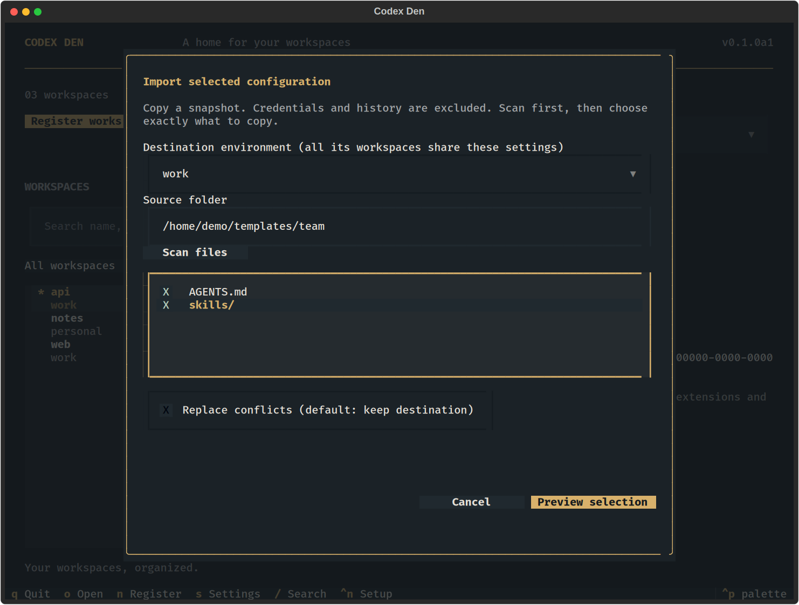
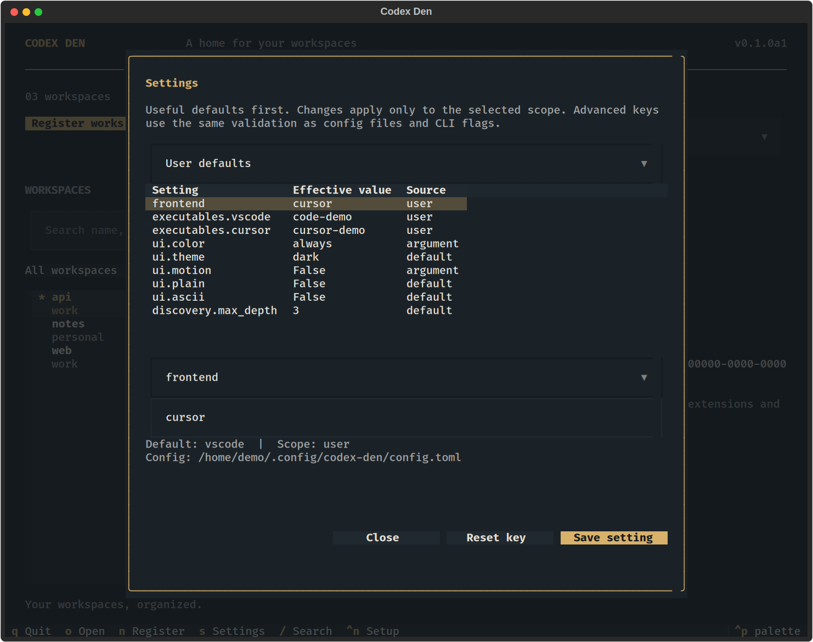

# Quick start

## 1. Install and open setup

Follow [installation](installation.md), then run:

```sh
codex-den setup
```

Choose **Cursor** or **VS Code**. If an editor is not detected, expand **Advanced** and choose its executable. Setup does not install an editor.



## 2. Register your workspace

Enter a name and an existing working folder. Keep **New independent environment** for a fresh home, or choose an existing environment to share all its managed settings, profiles, extensions, and Codex state.

Review the summary and choose **Finish setup**. Setup returns to the dashboard without opening an editor.



## 3. Prepare the extension and open

Choose **More actions → Install Codex extension**, select the environment and editor, then review and confirm. This installs the extension into that environment's managed editor storage. Sign in through the extension when necessary.

Select a workspace and choose **Open editor**, or press `o`. Every workspace in the same environment uses the same per-editor profile and Codex home.

## Bring your configuration

Choose **More actions → Copy configuration files**. Select the destination environment, enter a template folder, and scan it. Use Space to select files/folders, review the preview, then confirm. Existing destination files are kept unless replacement is selected.



Snapshots exclude credentials, dotenv/private-key files, history, and runtime state. Review arbitrary instruction and skill text before sharing it: text files can still contain sensitive information. See [workspace features](workspace-features.md) for clones, presets, and portable bundles.

## Change defaults

Open **Settings** (`s`) to inspect effective values and their sources. Select user, environment, or workspace scope. Shared-environment changes show the affected members before confirmation.



UI appearance preferences apply when the menu restarts. Disable motion with `codex-den config set ui.motion false`. Use `codex-den --plain` for linear prompts.

## Keyboard guide

| Key | Action |
| --- | --- |
| Tab / Shift-Tab | Move between controls; long forms scroll with focus |
| Arrow keys | Navigate workspaces and picker items |
| Enter | Open a picker or activate a button |
| Space | Toggle a file or repository selection |
| Escape | Close a picker first; press again to close its dialog |
| `/` | Focus workspace search |
| `n` / `s` / Ctrl-N | Register workspace / Settings / Setup |
| `o` / `q` | Open selected workspace / Quit dashboard |

Screenshots show demonstration data generated by [the capture script](../scripts/screenshots.py), not personal repositories or editor sessions. See [CLI reference](cli.md) for automation and [troubleshooting](troubleshooting.md) if something is missing.
